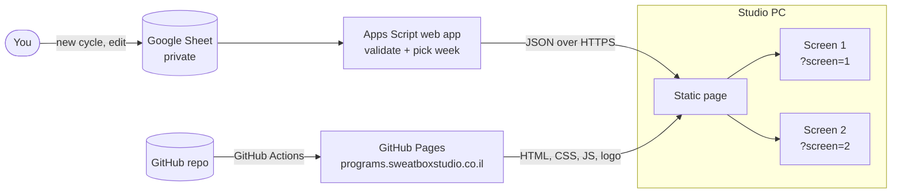
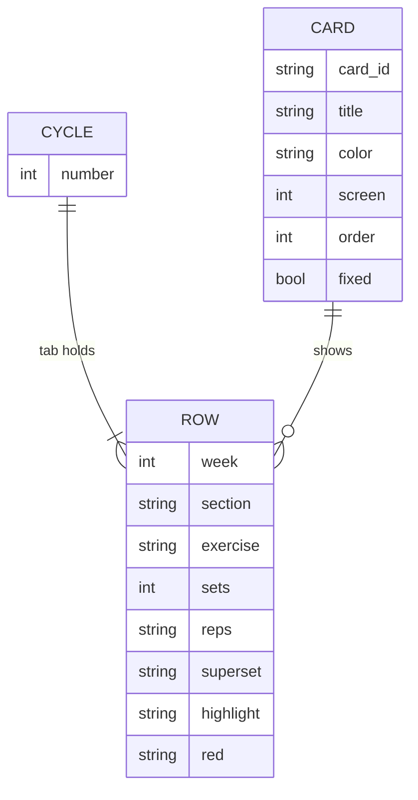
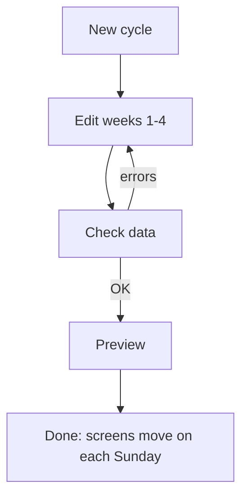
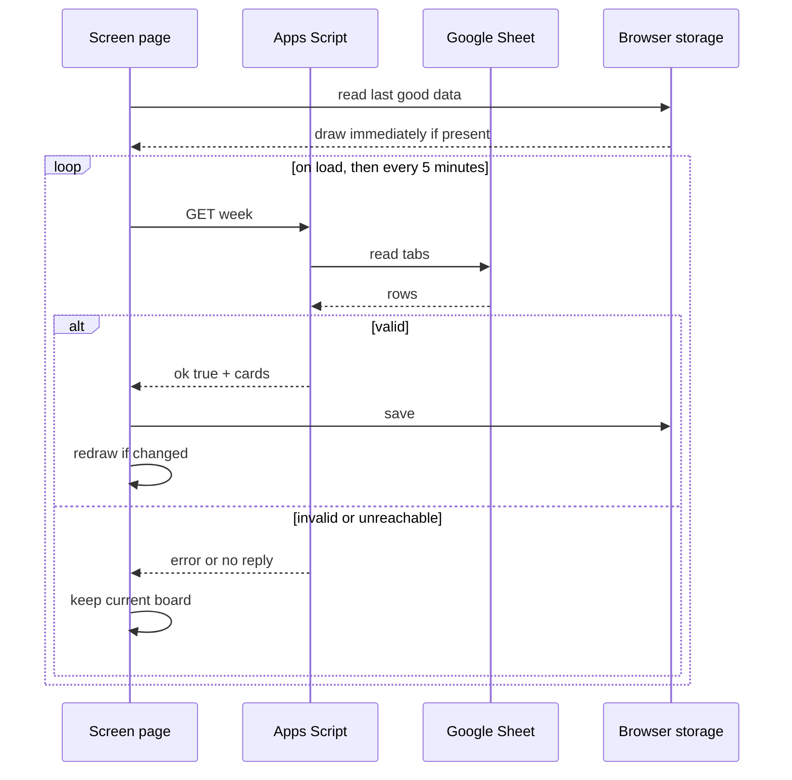
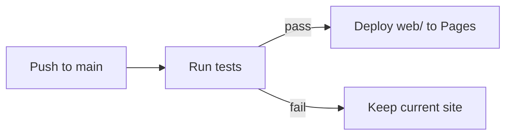

# SweatBox Studio Boards: Low-Level Design

Version 1.3 · 27 November 2026 · Address: `programs.sweatboxstudio.co.il`

## 1. Goal and decisions

You type programs as plain rows in one Google Sheet, prepare them a cycle at a time, and two studio screens style and switch themselves.

| Topic | Decision |
|---|---|
| Input and storage | One private Google Sheet. Past workouts stay in it and can be reused |
| API | Google Apps Script web app bound to the sheet (read only, no server to run) |
| Screens | Static HTML/CSS/JavaScript, no framework, no build step |
| Hosting and VCS | Public GitHub repository, GitHub Pages, deployed by GitHub Actions |
| Hardware | One PC, two landscape screens, one Chrome window each |
| Week switching | Every Sunday, counted continuously (1, 2, 3, 4, 1…), independent of months and years |
| Cycle | One sheet tab per 4-week cycle. The next tab takes over automatically; if it is missing, the previous cycle repeats from week 1 |
| Red highlighting | Automatic, with a per-row override |
| Look | Fresh dark redesign with logo; Hebrew (RTL) with English names |
| New cycle | "New cycle" menu copies the last tab, then you edit what changed |
| Code written by | Claude. You handle accounts, DNS, the studio PC and approval |

Confirmed: the studio PC runs Windows and both screens are 1920×1080. The PC needs internet access.

## 2. Screen stubs

The rendered mockups show real program content, so they are kept privately with the owner, not in this public repository.

### Layout wireframe (both screens)

```text
┌──────────────────────────────────────────────────────────────────────┐
│ [logo] SWEATBOX  <screen label>                    ▭ ▭ ▭ ▬  WEEK 4   │  header
├──────────────────────┬──────────────────────┬────────────────────────┤
│ SCREEN 1             │                      │                        │
│ Beginner protocol    │ PULL                 │ PUSH                   │
│ (spans both rows)    ├──────────────────────┼────────────────────────┤
│                      │ GLUTES & ABS         │ LEGS                   │
└──────────────────────┴──────────────────────┴────────────────────────┘
┌──────────────────────┬──────────────────────┬────────────────────────┐
│ SCREEN 2  B2         │ A2                   │ A1                     │
├──────────────────────┼──────────────────────┼────────────────────────┤
│ Weekly abs (א׳ + ב׳) │ C1                   │ B1                     │
└──────────────────────┴──────────────────────┴────────────────────────┘
```

Cards flow right to left, matching today's positions.

### Fallback states

```text
First load, no data yet        Fetch or data error             Nothing scheduled yet
┌──────────────────────┐       ┌──────────────────────┐        ┌──────────────────────┐
│       [logo]         │       │ last good board      │        │       [logo]         │
│     Loading…         │       │ stays on screen      │        │  Program coming soon │
│                      │       │              ● stale │        │                      │
└──────────────────────┘       └──────────────────────┘        └──────────────────────┘
```

The small amber "stale" dot appears after 30 minutes without a successful update. A small amber note such as "Apps Script v1 · expected v2" appears in the header when the deployed script's version differs from the one the page expects; with nothing on screen yet, the page says "Apps Script is out of date" instead of "Program coming soon".

## 3. Architecture



Content changes need only the sheet. GitHub is involved only when the code or design changes.

## 4. What a workout program is

A **cycle** has 4 weeks. Each week fills **cards**, and a card holds **sections** of exercise **rows**. The beginner protocol uses the same rows but never changes by week.



## 5. The Google Sheet

### `Cycle 1`, `Cycle 2`, … (where you work)

| week | card | section | exercise | sets | reps | superset | highlight | red |
|---|---|---|---|---|---|---|---|---|
| 1 | PUSH | | Exercise 1 | 4 | 14 | A | | |
| 1 | PUSH | | Exercise 2 | 4 | 10 | A | | |
| 1 | A2 | | Exercise 3 | 3 | 12+3 | | REST PAUSE | reps |
| 2 | ABS | Section title | Exercise 4 | 3 | 12 | | | |

- Rows are examples. `week` and `card` are dropdowns; filter on them to edit one card.
- There are no program IDs, schedule or per-week dates to maintain.
- `highlight`: red text after the exercise name.
- `red`: blank (automatic), `sets`, `reps`, `both` or `none`.
- A row with an exercise but no sets or reps is a text line.
- Text columns are **plain text**, so `8-12` and `01:00` are not turned into dates or times.

### `Fixed` tab
The same columns without `week`: content that does not rotate, such as the beginner protocol and its "משתלבים" note. The protocol's own "week 1/2/3" is unrelated to the cycle.

### `Cards` tab (set up once)

| card_id | title | color | screen | order | tall | auto_red | fixed |
|---|---|---|---|---|---|---|---|
| PUSH | PUSH · חזה, כתפיים, יד אחורית | #46b06a | 1 | 1 | no | yes | no |
| PROTOCOL | פרוטוקול למתאמן המתחיל | #f2c233 | 1 | 3 | yes | no | yes |

Each screen has a 3×2 grid; a `tall` card takes two cells.

### `Settings` tab
Brand name, screen labels and `cycle_1_starts` = `2026-11-01`, the single anchor date (week of 22/11 is week 4).

### Sheet menu "SweatBox"

| Action | What it does | Status |
|---|---|---|
| New cycle | Copies the latest cycle tab, with formatting, as the next number | In the setup script |
| Check and preview | Lists errors for a date and gives preview links for both screens | Built |
| Update card lists | Rebuilds the card dropdown on every cycle tab from `Cards` (also happens by itself when `Cards` is edited) | Script v3 |

To reuse an older workout, copy its rows from that cycle's tab.

### Your routine, once every 4 weeks



Edits to the **current** week appear on screen within about 5 minutes. A new cycle tab stays hidden until its first Sunday.

## 6. Rules

### Which week is shown

With `weeks` = whole weeks since `cycle_1_starts`, in `Asia/Jerusalem` calendar days:

- week in cycle = `weeks mod 4 + 1`
- cycle due = `weeks div 4 + 1`
- tab used = the highest existing `Cycle N` with rows, where N ≤ cycle due

| Sunday | Cycle due | Week |
|---|---|---|
| 22/11/2026 | 1 | 4 |
| 29/11/2026 | 2 | 1 |
| 27/12/2026 | 3 | 1 |
| 03/01/2027 | 3 | 2 |

The count ignores months and the year boundary. There is no holiday pause; weeks keep running.

Because New cycle copies the previous tab, a tab you have not edited yet shows the same programs again.

### Drawing

| Rule | Behaviour |
|---|---|
| Red sets | Sets other than 3, when the card has `auto_red` |
| Superset | Neighbouring rows with the same letter: "סופר סט" label, red bar, one shared red sets cell |
| Red reps | Text contains `MAX` |
| Override | The `red` column wins over the automatic rules |
| Too many rows | The card shrinks its text to fit; Check and preview warns above 9 rows |
| Mixed direction | Table is right to left; reps use `dir="auto"` so `8-12` does not flip |

### What blocks an update

Only mistakes in rows that would be on screen (this week's rows of the cycle tab in use) make the data invalid. Mistakes elsewhere, such as a half-typed row for another week, a wrong card in another week or an unknown card in `Fixed`, are warnings shown by **Check and preview**, so live updates keep flowing.

## 7. API

`GET <web-app-url>` returns the active week. `?date=YYYY-MM-DD` returns the week for that date (preview). A week with no rows counts as invalid data.

```json
{
  "version": 2,
  "ok": true,
  "cycle": 1,
  "week": 4,
  "startsOn": "2026-11-22",
  "cards": [
    {
      "id": "PUSH", "title": "PUSH · חזה, כתפיים, יד אחורית",
      "color": "#46b06a", "screen": 1, "order": 1, "tall": false,
      "sections": [
        { "title": "", "groups": [
          { "letter": "A", "sets": "4", "redSets": true, "rows": [
            { "exercise": "Exercise 2", "highlight": "", "reps": "10", "redReps": false }
          ] }
        ] }
      ]
    }
  ],
  "brand": "SWEATBOX",
  "labels": { "1": "SPLIT PROGRAM", "2": "FULL BODY PROGRAMS" },
  "warnings": []
}
```

On invalid data it returns `{"version": 2, "ok": false, "errors": ["..."], "warnings": [...]}` and the screens keep the last good board. The API applies all the rules, so the page only draws.

`version` is `SCRIPT_VERSION` in `apps-script/api.js`. It must equal `EXPECTED_SCRIPT_VERSION` in `web/config.js`; a test fails if they differ. Raise both whenever any Apps Script file changes.

Deployment settings: **Execute as: Me**, **Who has access: Anyone**. When updating the script, publish a new version of the *same* deployment so the URL does not change.

### Refresh flow



Every night at 04:00 (the PC's clock) the page reloads itself to pick up new code, but only after checking that the site is reachable; if it is not, it retries every 10 minutes and keeps the current board meanwhile.

## 8. Code design

```text
sweatbox-programs/
├── web/                    # published to GitHub Pages
│   ├── index.html          # one page for both screens (?screen=1|2)
│   ├── styles.css
│   ├── config.js           # API URL, expected script version, refresh and reload times
│   ├── data.js             # fetch, last-good cache, version check, nightly reload
│   ├── render.js           # card -> DOM, fit to 1920×1080
│   └── assets/             # logo
├── apps-script/
│   ├── api.js              # doGet, SCRIPT_VERSION
│   ├── model.js            # pure rules: week, validation, red, supersets
│   ├── menu.js             # new cycle and check menu
│   └── setup.js            # creates the tabs
├── tests/                  # node --test
├── kiosk/start-boards.bat
├── .github/workflows/pages.yml
└── README.md
```

- **DRY:** one page, one card renderer and one row model for every card type.
- **Add or move a card:** a row in `Cards`, then use its id in the cycle tabs; no code change while it fits the 3×2 grid.
- **Safety:** insert sheet text with `textContent`, never as raw HTML.
- **Scaling:** draw a fixed 1920×1080 stage and scale it to the window.
- **Font:** Heebo from Google Fonts, falling back to Arial.
- **Tests:** week counting, red rules, superset grouping, validation.
- **Apps Script code:** kept in GitHub and copied into the script editor on the rare changes.

## 9. Deployment



**Domain**
1. Verify the domain in GitHub (prevents takeover).
2. In the repository's Pages settings, set the custom domain to `programs.sweatboxstudio.co.il`.
3. At your DNS provider, add `CNAME programs → <your-github-user>.github.io`.
4. Enable **Enforce HTTPS** (can take up to 24 hours to become available).

**Studio PC** (`kiosk/start-boards.bat`, not yet tested on the real machine)

The file opens one full-screen Chrome window per screen, each with its own profile folder so it can take its own position. It suppresses Chrome's welcome screens, translate prompt and "restore pages" bubble. Put a shortcut in the Windows Startup folder, set displays to "Extend" at Scale 100%, and turn off sleep. After the custom domain is live, change `PAGE` in the file.

## 10. Cost, privacy and risks

**Expected running cost: 0**, apart from the domain you already own. Two screens polling every 5 minutes make 576 requests a day.

| Item | Note | Mitigation |
|---|---|---|
| Open data | No login: anyone with the page or API address can read programs, including future weeks via `?date=` | Keep member details out of the sheet |
| Public code | Others can see and fork it | Add no open-source licence; commit no private data |
| Browser access to Apps Script | Confirmed working from GitHub Pages on 26/11/2026 (connection test) | If Google changes this, fall back to JSONP |
| GitHub Pages terms | **Decision: use GitHub Pages.** It bars free hosting to run an online business, e-commerce or commercial SaaS. This read-only studio display does none of these (my reading of the terms, not a ruling from GitHub) | Revisit if the site ever takes bookings, payments or serves other businesses |
| Internet outage | An open page keeps the last board; a PC restarted offline cannot load the page | Accepted for this scope |
| Free service changes | Google or GitHub can change limits | Plain files, easy to move |

## 11. Effort estimate

These are judgement-based estimates, not measurements. "Developer days" shows the equivalent size if a person wrote it by hand.

| Phase | Output | Developer days | Your time (hours) | Status, 27/11 |
|---|---|---|---|---|
| 0. Setup and proof | Repo, test API reaching the page, DNS | 0.25 | 1 | Done except DNS |
| 1. Sheet | Cycle tabs, dropdowns, existing programs loaded | 0.5 | 1.5–2 | Set up; week 4 seeded, needs proofreading |
| 2. API and menu | Rules, tests, new cycle, check | 1 | 0.5 | Code done; deploy version 2 |
| 3. Screens | Redesign, fitting, offline cache | 1.5 | 1–2 | Done; check in the studio |
| 4. Go live | Pages, domain, studio PC | 0.5 | 1–2 | Pages live; domain and PC to do |
| 5. Parallel week | Old sheets kept as backup, fixes | 0.25 | 1 | Not started |
| **Total** | | **about 4 (range 3–5)** | **about 6–8.5** | |

With Claude writing the code, expect a few working sessions; your time is mostly setup, proofreading and checking the screens.

**Still needed from you:** deploy Apps Script version 2, enter Cycle 2 week 1 before Sunday 29/11/2026, DNS access for the domain, and testing on the studio PC. An SVG logo would be sharper than the current PNG.

## 12. Acceptance checklist

- [ ] Both screens start by themselves after a PC restart
- [ ] All cards fit without scrolling and are readable from the training floor
- [ ] A sheet edit appears within about 5 minutes
- [ ] The next week, and the next cycle, appear on their Sunday
- [ ] A typo in the sheet does not blank the screens
- [ ] Creating a cycle takes one menu action

## 13. Open issues (review of 27/11/2026)

Fixed: nightly reload, only the week on screen can block updates, script version check, kiosk flags.

| # | Issue | Suggested fix |
|---|---|---|
| 5 | Pasting can turn reps such as `8-12` into dates, which pass the checks | Done (script v3): Check and preview warns when reps look like a date or time; paste with Ctrl+Shift+V |
| 6 | `cycle_1_starts` is not checked to be a Sunday | Done (script v3): other weekdays and impossible dates are rejected |
| 7 | The script requests access to all the owner's spreadsheets | Done (script v3): `@OnlyCurrentDoc`; the owner re-approves once |
| 8 | A new card needs a manual dropdown edit; card ids are case-sensitive | Done (script v3): dropdowns rebuild from `Cards` on edit, on New cycle and from Update card lists; ids ignore capital letters |
| 9 | A blank sets cell in a superset is reported as "different sets" | Done (script v3): the message names the empty first row |
| 10 | Nothing stopped private data being committed | Done: `.gitignore` for seed and export files |

Also open: custom domain, studio PC test, proofreading the seeded week 4, legibility from the training floor.

## References
- [Apps Script web apps](https://developers.google.com/apps-script/guides/web)
- [Apps Script quotas](https://developers.google.com/apps-script/guides/services/quotas)
- [GitHub Pages limits](https://docs.github.com/en/pages/getting-started-with-github-pages/github-pages-limits)
- [GitHub Pages custom domains](https://docs.github.com/en/pages/configuring-a-custom-domain-for-your-github-pages-site/managing-a-custom-domain-for-your-github-pages-site)
- [Chrome window positioning discussion](https://groups.google.com/a/chromium.org/g/chromium-discuss/c/zPi3gOzT-9w)
